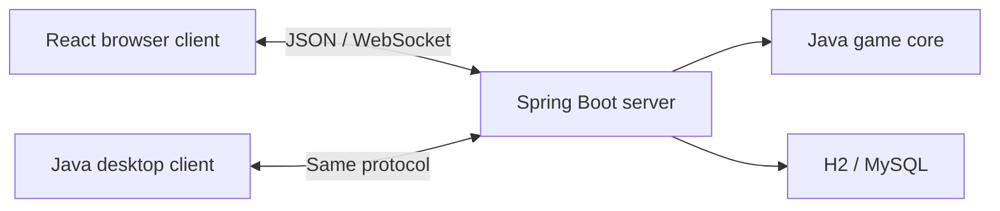

  

<h1 align="center">Santorini</h1>

  <strong>Build the island. Reach the summit.</strong> 
  A strategy game for two to four players, with browser and Java desktop cross-play.

  <a href="https://santorini.vaell.dev"><strong>Play online</strong></a>
  &nbsp;·&nbsp;
  <a href="#choose-your-game">Game modes</a>
  &nbsp;·&nbsp;
  <a href="#architecture">Architecture</a>
  &nbsp;·&nbsp;
  <a href="https://github.com/Vael2196/Santorini/issues">Report an issue</a>

  
  
  
  

Move your workers, raise towers and shape the paths across a shared five-by-five board. Climb from
level two to level three to win—or build a dome to close a route before someone else gets there.

Santorini brings a university Java/Swing project to the web through a shared game core, a Spring Boot
server and a React/TypeScript client. Play a friend, join the public queue, practise against the
computer or compete in ranked Classic duels.

## At the table

- **Public and private rooms.** Find players using the same mode and rules, or share an eight-character
  room code with friends.
- **Browser and desktop cross-play.** Both clients join the same rooms and use the same authoritative
  game server.
- **Guests and accounts.** Enter without a password as a guest, or create an account to reserve your
  name, save preferences and play ranked games. No email address is required.
- **Ranked Classic duels.** Elo ratings reflect the strength of your opponent. Matchmaking favours
  nearby ratings and widens its search over time; completed results feed the leaderboard.
- **Computer practice.** Play an unranked duel against the computer, with Classic rules or god
  powers.
- **Room chat.** Text-only messages with length and rate limits, link blocking and a basic word filter.
- **A parchment game board.** Isometric tiles, handwritten type, numbered workers and tool cursors,
  with optional tower-level labels, four cursor colours, keyboard controls, sound volume and mute.

## Choose your game

| Mode | Players | Workers per player |
| --- | --- | --- |
| Computer practice | You and the computer | 2 |
| Duel | 2 | 2 |
| Three-player free for all | 3 | 2 |
| Four-player free for all | 4 | 1 |
| Teams | 4, in two teams | 1 |

Two- and three-player games support Classic rules or god powers. Four-player games use Classic
rules; in teams, seats **1 and 3** play against **2 and 4**. Ranked play is limited to Classic duels
between registered accounts. Computer practice and the larger modes are unranked.

Ratings start at **1200**, with a provisional label for the first ten completed ranked games. A win
against a higher-rated opponent earns more points than a win against a lower-rated opponent.

## How to play

1. Open [the game](https://santorini.vaell.dev), choose a guest name or log in, then enter a room.
2. Choose a god power if the room uses them, mark yourself ready and place your workers on empty tiles.
3. On your turn, select a worker, move to an empty neighbouring tile, then build beside it. Diagonals count.
4. Climb from level two to level three to win. Domes block movement; a player without a legal action
   leaves play. In a free for all, the remaining players continue. In teams, a win or forfeit settles
   the whole team.

| Power | Effect in this project |
| --- | --- |
| Artemis | An optional second move, without returning to the starting tile |
| Demeter | An optional second build, on a different neighbouring tile |
| Triton | Additional moves while each step stays at the same height |

**Rules variant:** this implementation preserves the original project's one-level limit for both
climbing and descending. Triton's same-height movement is also a project variant. The available
powers and rules differ from the published game's full catalogue.

## Architecture

The server owns the online board. Clients submit actions; the server validates the player's seat,
turn, room version and legal moves before broadcasting the next snapshot.

| Component | Responsibility |
| --- | --- |
| [Game core](game-core) | Headless rules, board state, god strategies and shared protocol records |
| [Multiplayer server](multiplayer-server) | Rooms, matchmaking, computer turns, accounts, chat and rating settlement |
| [Web client](web-client) | React, TypeScript and Vite; an interactive SVG board with locally served artwork and audio |
| [Desktop client](desktop-client) | The original Swing game and its network view, built against the shared Java core |
| SQL and Flyway | Persistent accounts, preferences, sessions and ranked results, with versioned schema migrations |
| Docker Compose and Nginx | Separate application containers, static-file delivery and HTTP/WebSocket proxying |

The Java core is loaded as a library. Browser rendering stays on the client, while one Spring Boot
process coordinates online rooms. H2 supports local persistence; MySQL supports the shared-server
deployment on AWS Lightsail.

### Engineering decisions

- **Keep the rules in one place.** A headless core reuses the original Java model and god strategies
  across the server and desktop builds.
- **Validate state transitions.** Room-scoped locking serialises game actions, and snapshot versions
  reject stale updates. A temporary disconnection pauses play and reserves the seat for recovery.
- **Settle ratings once.** Each ranked match has a unique settlement ID. A SQL transaction updates
  both ratings and the result together; retries return the recorded changes.
- **Separate identity from display names.** Registered and guest names share a normalised namespace.
  Accounts use BCrypt password hashes, hashed session secrets, HttpOnly cookies and CSRF protection.
- **Keep the deployment small.** SVG rendering and static assets support the board without a 3D
  runtime. Separate Compose projects and database credentials let the deployment share a host with
  other applications.

See the [architecture notes](docs/ONLINE.md) for protocol fields, concurrency boundaries, matchmaking,
chat limits and the account lifecycle. Operational run notes are maintained separately from this
public project overview.

## Quality and current scope

[GitHub Actions](https://github.com/Vael2196/Santorini/actions/workflows/online.yml) builds the Java
modules and web client, then runs:

| Checks | What they exercise |
| --- | --- |
| Java unit and integration tests | Legal actions, god powers, multiplayer modes, computer decisions, room isolation, accounts, rating settlement and protocol compatibility |
| React integration tests | The real interface against the server, including preferences, solo play, multiplayer modes and chat |
| Playwright browser tests | Room flows, reconnection, ranked results, account preferences, mobile layout and keyboard interaction |

Automated database checks use H2.

The online deployment currently uses **one game-server instance**. Accounts, preferences and
completed ranked results persist. Rooms and chat history are held in memory; a restart ends active
rooms and voids unfinished ranked games. Spectating, password recovery and saved online matches
are not currently implemented.

Custom maps, local save files and the Tag-inspired mode remain desktop features. The historical
executable in this repository predates online play; the current desktop source includes the network
client.

## Feedback and contributions

Found a bug or have a small improvement in mind? [Open an issue](https://github.com/Vael2196/Santorini/issues)
with the steps to reproduce it, your browser or desktop client version, and the expected and actual
behaviour. For a larger change, discuss the approach in an issue before opening a pull request.

## Credits and licences

The original desktop application was developed by **Team024**, including **Vadim Filyakin**
(`vfil0001`). Subsequent work by [Vadim Filyakin (that's me :D)](https://github.com/Vael2196) extends it with the
online game service, browser interface and deployment architecture.

Artwork and audio licence notices are kept in
[assets/licences](web-client/public/assets/licences). The self-hosted Kalam font uses the
[SIL Open Font Licence](web-client/public/assets/licences/Kalam-OFL.txt).
